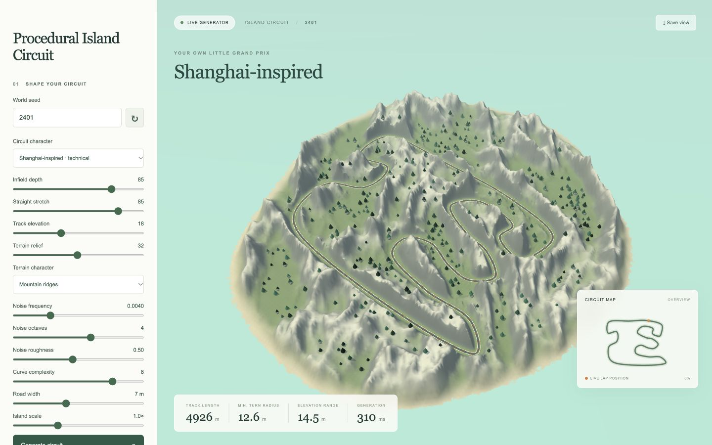
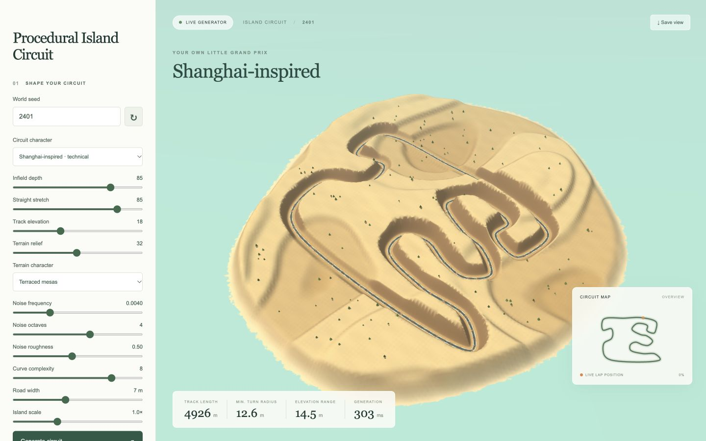
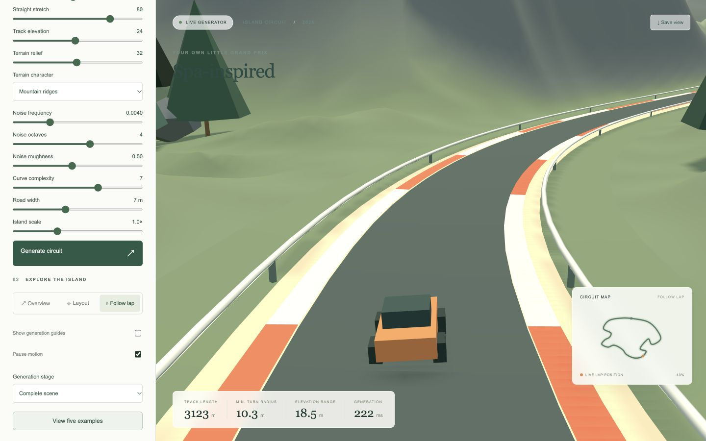

## Milestone #1

The browser demo generates a complete island circuit from a seed and a layout preset. It samples a closed Catmull–Rom spline, checks the sampled layout for crossings, tight turns, and insufficient clearance, and builds the road, curbs, and barriers. Layered gradient noise shapes the terrain and track elevation. The demo includes an overview, a top-down layout, and a camera that follows a lap.

Run from the repository root with Python 3 and open [the local demo](http://127.0.0.1:5660/) in a WebGL-capable browser. Select a preset or enter a seed, then click **Generate circuit**.

```sh
python3 -m http.server 5660 --bind 127.0.0.1 --directory demo
```

The demo uses JavaScript and bundles Three.js. 

**Shanghai-inspired, seed 2401.** The top-down debug view shows the sampled centerline and control points.


**Spa-inspired, seed 5660.** The terrain debug view shows the untextured mesh and the road cut through the hills.


## Milestone #2

### Progress

The full working copy is `demo/index.html`. The main generator is implemented end to end: a seed and parameters produce a closed circuit, sampled geometric checks, an elevated road mesh, an island terrain mesh, and road-aware environment placement. Three.js renders the generated geometry.

- Three original macro layouts inspired by Shanghai, Spa, and Silverstone are deformed with seeded stretching, shearing, smooth warps, and local offsets. Infield depth, straight stretch, complexity, width, and scale are adjustable. The generator preserves the base corner ordering rather than creating arbitrary topology.
- A closed centripetal Catmull–Rom spline is sampled at approximately equal arc distances. Sampled crossing, nonlocal clearance, and turn-radius checks reject invalid candidates. Bounded retries record rejection reasons and explicitly report an oval fallback if needed.
- Noise-based track elevation is reduced when sampled grades exceed the 14% target. Four surrounding terrain characters—hills, mountain ridges, terraced mesas, and a volcanic caldera—use different height constructions. Frequency, octaves, persistence, and relief are adjustable.
- Bug fixes limit the road-to-terrain transition width to preserve infield relief. Adaptive terrain cells are no larger than 2 m near the road, with shared coarse/fine boundaries. Trees and rocks query the rendered terrain triangles for surface contact; placement also filters road proximity, slope, and coast.
- The working demo includes curbs, guardrails, start/finish geometry, an animated car, a mini-map, three camera modes, generation-stage visualization, five reproducible examples, pause, and image export.

### Scope adjustments and remaining issues

I replaced the original radial-point layout proposal with three macro layouts and seeded deformation to obtain more structured corner sequences. I implemented the project in JavaScript ES modules rather than the proposed TypeScript architecture.

I chose track elevation as the extension and cut manual driving and checkpoints to focus on the generator. I also cut full road-triangle overlap validation and the full Bridson active-list sampler from this milestone; the implementation uses sampled geometric checks and minimum-distance rejection sampling instead. These choices kept the core generation pipeline working within the milestone schedule.

Finite sampling and mesh resolution can still produce small artifacts at sharp cuts or extreme settings. The fallback is usable but is a simple oval rather than a complex generated layout. The remaining work focuses on visual transitions, supported parameter tuning, and final presentation rather than adding new core engine features.

### Current generator output

The first two images use the same Shanghai-inspired layout, seed **2401**, and road settings; only the terrain character changes. Common settings: width 7, scale 1, complexity 8, infield 85, straight stretch 85, track elevation 18, terrain relief 32, noise frequency 0.004, 4 octaves, and persistence 0.5.

**Mountain ridges — Overview.** The complete circuit with generated mountain chains, rock coloring, vegetation, and trackside geometry.



**Terraced mesas — Overview.** The same road with flat-top terrain, stepped slopes, and sparser vegetation.



**Spa-inspired, seed 2026 — Follow lap.** Mountain ridges, track elevation 24, terrain relief 32, complexity 7, infield 65, straight stretch 80; other noise, width, and scale settings match above. The camera shows the elevated road, curbs, barriers, and terrain transition at track level. Camera position changes with lap progress.


